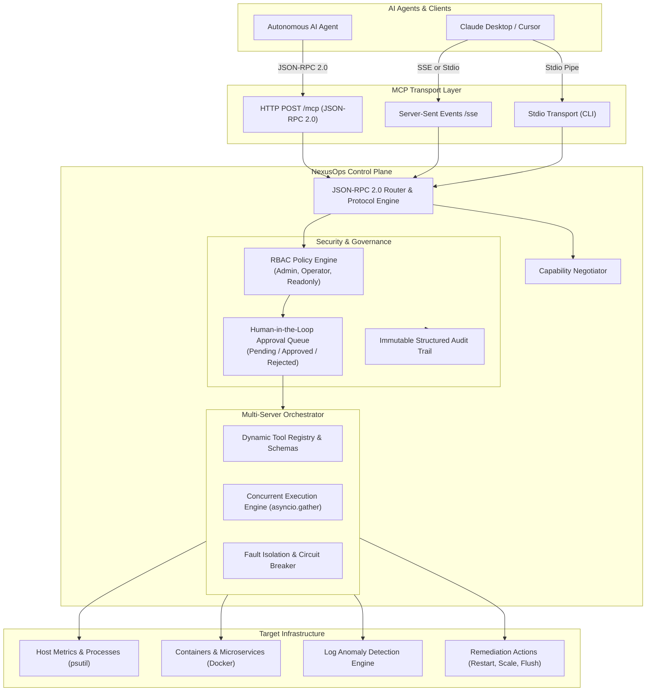

# NexusOps – Autonomous AI Infrastructure Control Plane

[](https://www.python.org/downloads/)
[](https://spec.modelcontextprotocol.io)
[](https://www.jsonrpc.org/specification)
[](https://fastapi.tiangolo.com)
[](LICENSE)

**NexusOps** is an enterprise-grade control plane enabling autonomous AI agents (such as Claude, custom LLM agents, and AutoGPT-style systems) to safely discover, inspect, monitor, and remediate cloud and container infrastructure.

Built strictly against the official **Model Context Protocol (MCP)** specification over **JSON-RPC 2.0**, NexusOps bridges the gap between probabilistic AI reasoning and deterministic infrastructure operations through **Role-Based Access Control (RBAC)**, **Human-in-the-Loop (HITL) safety gates**, and **fault-isolated multi-server orchestration**.

---

## 🏛️ System Architecture



---

## 🚀 Key Architectural Pillars

### 1. Custom Model Context Protocol (MCP) Server with JSON-RPC 2.0
- **Strict Protocol Compliance**: Implements the official MCP specification (`2024-11-05`) over JSON-RPC 2.0 envelopes.
- **Multiple Transports**:
  - `POST /mcp`: High-throughput HTTP JSON-RPC 2.0 endpoint supporting single and batch requests.
  - `GET /sse`: Server-Sent Events stream for reactive agents and IDEs.
  - `stdio`: Direct CLI pipe mode for Claude Desktop, Cursor, or local orchestration pipelines.
- **Full MCP Primitives**: Exposes `tools` (executable operations), `resources` (live metrics, logs, topologies), and `prompts` (guided diagnostic and remediation runbooks).

### 2. Capability Negotiation & Dynamic Tool Discovery
- **Runtime Handshake**: AI clients negotiate capabilities during `initialize` (`roots`, `sampling`, `experimental`), receiving server capabilities (`tools.listChanged`, `resources`, `prompts`).
- **Dynamic Schema Introspection**: Python functions decorated with `@mcp_tool` are automatically parsed using reflection and Pydantic type annotations to generate standard JSON Schema parameter specifications.
- **Structured Execution**: Invocations via `tools/call` validate parameters, sanitize inputs, enforce timeouts, and return standardized MCP content blocks (`TextContent`, `isError`).

### 3. Multi-Server Orchestration & Fault Isolation
- **Federated Tool Catalog**: The orchestrator can federate multiple remote node-level MCP servers and aggregate their tool catalogs under namespaced identifiers (`node-east::restart_service`).
- **Concurrent Execution Engine**: Executes complex multi-step remediation plans concurrently using `asyncio.gather` bounded by configurable concurrency semaphores.
- **Fault Isolation & Circuit Breaking**: Each tool invocation executes within an isolated `FaultIsolationBoundary`. If a specific service is crashing or timing out:
  - The failure is isolated; healthy tasks in the batch continue unaffected.
  - The `CircuitBreaker` trips to `OPEN` after repeated consecutive failures, preventing cascading resource exhaustion.

### 4. Governance, RBAC, and Human-in-the-Loop (HITL) Workflows
- **Role Hierarchy**:
  - `readonly`: Query metrics, view active processes, inspect containers, read logs.
  - `operator`: Non-destructive state modifications (graceful service restart, horizontal scaling, cache flushes).
  - `admin`: Destructive or critical operations (kill processes, terminate containers, prune storage).
- **Safety Tiers**: Operations are classified into `SAFE`, `MODERATE`, and `CRITICAL`.
- **HITL Interception Queue**: When an autonomous agent attempts a `CRITICAL` tool:
  1. The action is paused and placed in the **Pending Approvals Queue**.
  2. The server responds with `status: "pending_approval"`, returning a unique `approval_id`.
  3. A human engineer reviews the request via the **NexusOps Web Control Plane** and signs off.
  4. The agent re-submits the invocation with `approval_id` to execute the action.

---

## 🛠️ Tool Catalog

| Tool Name | Safety Tier | Required Role | Requires Approval | Description |
|---|---|---|---|---|
| `get_system_metrics` | `SAFE` | `readonly` | No | Host CPU, RAM, Disk, and Network I/O metrics. |
| `list_active_processes` | `SAFE` | `readonly` | No | Top processes sorted by CPU or memory usage. |
| `probe_network_port` | `SAFE` | `readonly` | No | TCP socket probe verifying host/port connectivity. |
| `list_containers` | `SAFE` | `readonly` | No | Lists managed containers, states, and health. |
| `inspect_container` | `SAFE` | `readonly` | No | Deep inspection of ports, image, memory, and logs. |
| `get_container_logs` | `SAFE` | `readonly` | No | Fetches recent container stdout/stderr logs. |
| `analyze_service_logs` | `SAFE` | `readonly` | No | Regex anomaly detection, OOM/crashloop diagnosis. |
| `check_service_health` | `SAFE` | `readonly` | No | Evaluates health checks and generates advice. |
| `restart_service` | `MODERATE` | `operator` | No | Gracefully restarts a container or service. |
| `scale_service` | `MODERATE` | `operator` | No | Adjusts horizontal replica count. |
| `flush_cache` | `MODERATE` | `operator` | No | Clears Redis memory to remediate OOM crashes. |
| `terminate_container` | `CRITICAL` | `admin` | **Yes (HITL)** | Destructively stops/kills a container. |
| `prune_system_resources` | `CRITICAL` | `admin` | **Yes (HITL)** | Prunes dangling images, volumes, and storage. |

---

## 💻 Installation & Quickstart

### Prerequisites
- Python 3.11+
- Virtual environment (recommended)

### 1. Clone & Set Up Environment
```bash
# Clone the repository
git clone https://github.com/your-org/nexusops.git
cd nexusops

# Create and activate virtual environment
python3 -m venv .venv
source .venv/bin/activate

# Install dependencies
pip install -r requirements.txt
```

### 2. Run the NexusOps Control Plane
```bash
python -m nexusops.main
```
The server will start at:
- **Web Control Plane Dashboard**: [http://127.0.0.1:8000](http://127.0.0.1:8000)
- **MCP JSON-RPC 2.0 Endpoint**: [http://127.0.0.1:8000/mcp](http://127.0.0.1:8000/mcp)
- **MCP Server-Sent Events (SSE)**: [http://127.0.0.1:8000/sse](http://127.0.0.1:8000/sse)
- **Interactive Swagger API Docs**: [http://127.0.0.1:8000/docs](http://127.0.0.1:8000/docs)

### 3. Run the Autonomous AI Agent Demo
In a separate terminal:
```bash
source .venv/bin/activate
python examples/mcp_client_example.py
```
This triggers an autonomous agent run that negotiates capabilities, performs dynamic discovery, diagnoses an unhealthy Redis service from log anomalies, remediates via `flush_cache`, and tests the HITL safety gate.

---

## 🧪 Running the Automated Test Suite

NexusOps includes a comprehensive test suite covering protocol adherence, RBAC, human approvals, orchestrator concurrency, and fault isolation:

```bash
source .venv/bin/activate
pytest -v
```

---

## 🤖 Claude Desktop & Cursor Integration

To connect Claude Desktop or Cursor directly to NexusOps, add the following to your `claude_desktop_config.json`:

```json
{
  "mcpServers": {
    "nexusops": {
      "command": "python",
      "args": ["-m", "nexusops.main", "--stdio"],
      "env": {
        "NEXUSOPS_ADMIN_API_KEY": "nexus-admin-secret-key-12345"
      }
    }
  }
}
```

---

## 🐳 Docker & Docker Compose Deployment

NexusOps is fully containerized and includes a multi-service sample topology:

```bash
# Build and run NexusOps with target demo containers (Redis, Nginx)
docker compose up --build -d

# Verify health status
curl http://localhost:8000/api/status
```

---

## 🎯 Interview Deep Dive & Technical Questions

<details>
<summary><strong>1. Why use Model Context Protocol (MCP) instead of standard OpenAPI / REST endpoints?</strong></summary>

While REST endpoints define schemas, they lack a standardized protocol handshake for capability negotiation (`initialize`), bidirectional notification channels (`listChanged`), and unified primitives for tools, contextual resources, and prompt templates. MCP creates a universal protocol layer so any AI agent can connect to any infrastructure toolset without bespoke wrapper code.
</details>

<details>
<summary><strong>2. How does NexusOps prevent an autonomous AI agent from hallucinating destructive commands?</strong></summary>

Safety is enforced at the protocol and registry layer, not through prompt engineering. All tools have an assigned `SafetyTier` (`SAFE`, `MODERATE`, `CRITICAL`) and `Role`. Critical operations (`terminate_container`, `prune_system_resources`) automatically trip an execution interceptor that suspends execution, registers an approval token in the HITL state machine, and mandates human authorization before proceeding.
</details>

<details>
<summary><strong>3. How does fault isolation work during concurrent tool execution?</strong></summary>

Each tool execution runs within an isolated `FaultIsolationBoundary` backed by an asynchronous circuit breaker (`CircuitBreaker`). When executing multi-tool plans concurrently (`asyncio.gather`), an exception or timeout in one tool is trapped and wrapped in a structured error result. Healthy tasks in the same batch complete normally, preventing cascading failures across infrastructure clusters.
</details>
